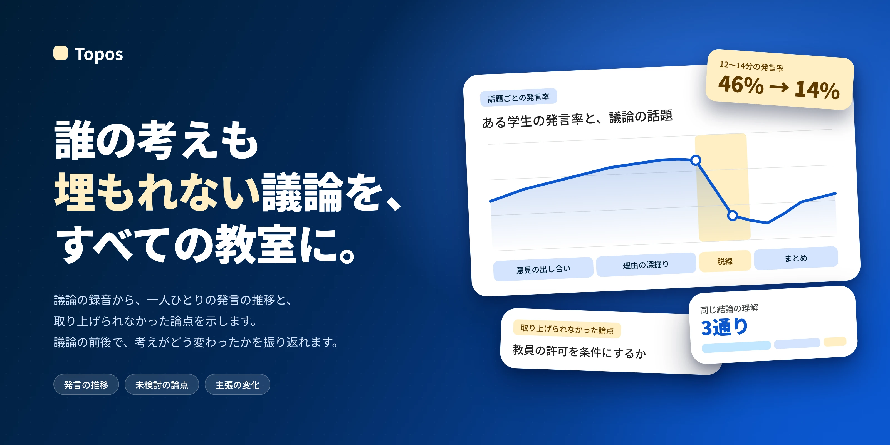
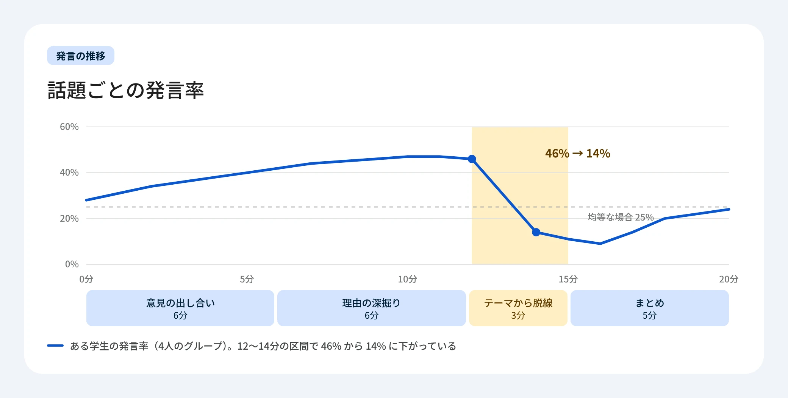
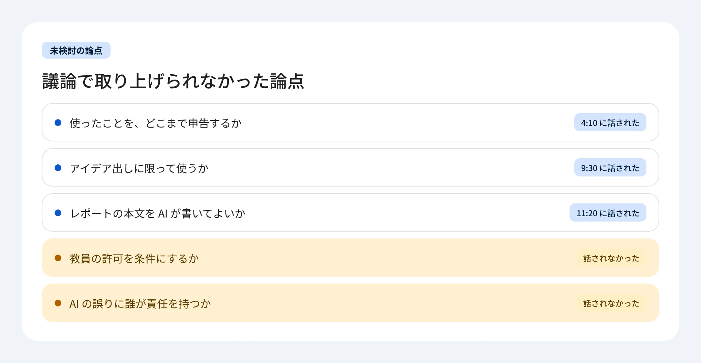
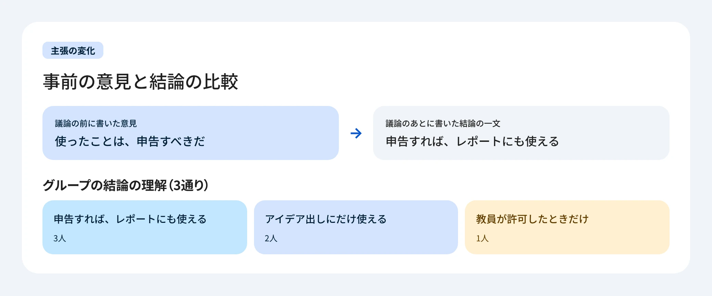
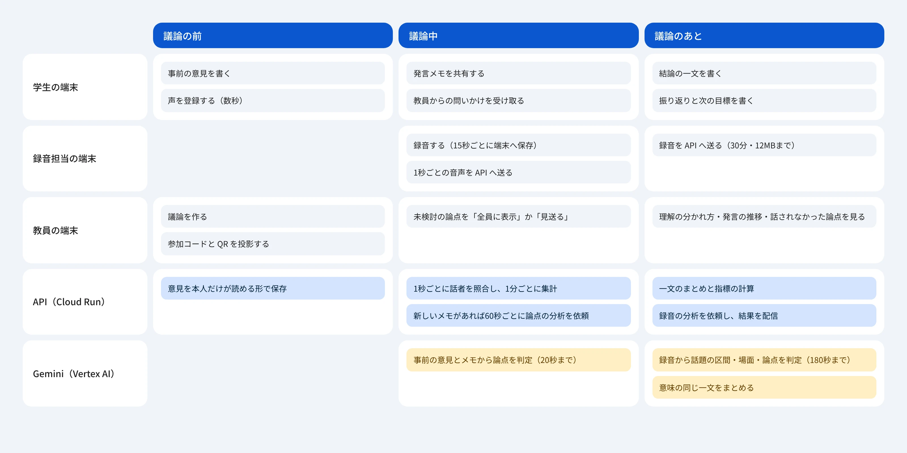
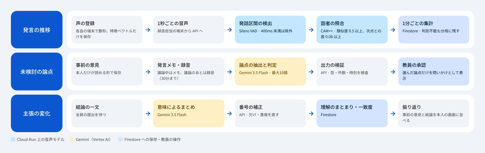

# Topos

**誰の考えも埋もれない議論を、すべての教室に。**

[](https://web--devfest2026-t167.asia-east1.hosted.app)

<!-- 提出前に記入：デモ動画の URL ができたら、次の行の「作品」の後ろに · [デモ動画](URL) を足す -->
[作品](https://web--devfest2026-t167.asia-east1.hosted.app) · [アーキテクチャ](#アーキテクチャ) · [技術選定](#技術選定) · [ドキュメント](docs)

Topos（トポス）は、グループディスカッションで埋もれた考えを AI が見つけ、全員の考えが活かされる議論にするための学習支援アプリである。会議の AI が話されたことを記録するのに対し、Topos は話されなかった論点、話せなくなった参加者、合意の裏にある理解のずれを見つけ、学生と教員の次の一歩につなげる。

## 課題

グループでの話し合いは、小学校の 89.5%、中学校の 85.4% が授業に取り入れ、大学生の 81% が経験している。一方で、話す人は偏り、言えなかった意見や疑問は検討されないまま消え、「全員賛成」でも一人ひとりの理解はずれたまま終わる。日本の中学校の教員の勤務は週 55.1 時間に及び、複数のグループを同時に見て、一人ひとりのつまずきに気づく余裕はない。

出典：国立教育政策研究所「全国学力・学習状況調査」（2026）、文部科学省「全国学生調査」（2025年度）、OECD「TALIS 2024」

| | 発言の量 | 議論の中身 | 話されなかった論点 | 一人ひとりの考えの変化 |
|---|---|---|---|---|
| 授業音声の分析ツール | ○ | — | — | — |
| 会議の AI の要約 | — | ○ | — | — |
| Topos | ○ | ○ | ○ | ○ |

## 発言の推移



学生は、自分がどの話題のときにどれだけ話したかを振り返り、次の議論で試すことを決める。教員は、グループ全員の推移から、話せなくなった学生とその場面をつかみ、声をかける。

## 未検討の論点



議論の前に一人ひとりが書いた意見のうち、まだ話されていない論点を、議論の最中に教員へ知らせる。教員が選んだ論点は、問いかけとして全員の画面に届き、議論に戻る。議論のあとは、最後まで話されなかった論点がグループごとに残る。

## 主張の変化



学生は、議論の前の自分の意見と結論を並べて、考えがどう変わったかを確かめる。教員は、同じ結論の理解が何通りに分かれたかを見て、次の授業で扱う点を決める。

## アーキテクチャ


教室の端末はテキストと音声を Cloud Run の API に送り、API が話者の推定と Gemini による分析を行って Firestore に書く。端末は Firestore を直接読まず、API が認可した変更だけを受け取る。



### 処理の流れ



### 実行環境

| コンポーネント | サービス | リージョン | 構成 |
|---|---|---|---|
| フロントエンド | Firebase App Hosting（Next.js） | asia-east1 | 0〜4 インスタンス |
| API・話者の推定 | Cloud Run（Express + TypeScript、Python のモデルを同梱） | asia-northeast1 | 2 vCPU・2 GiB、0〜2 インスタンス、同時 8 リクエスト |
| データ | Cloud Firestore | asia-northeast1 | — |
| 認証 | Firebase Authentication（Google） | — | — |
| 議論の分析 | Gemini 3.5 Flash（Vertex AI） | global | 思考 LOW、temperature 0 |

外部（Vertex AI の global エンドポイント）に送るのは、事前の意見・発言メモ・結論の一文の本文と録音だけで、名前・ID・参加コードは送らない。録音は保存しない。

### データ

| パス | 内容 | 閲覧権限 |
|---|---|---|
| `sessions/{議論}` | テーマ・段階・グループの進み具合 | 所属するメンバー |
| `…/privateOpinions/{利用者}` | 事前の意見 | 本人 |
| `…/consensusStatements/{利用者}` | 結論の一文 | 本人 |
| `…/messages` | 発言メモ | 所属するメンバー |
| `…/insights` | 未検討の論点（議論中） | 教員。承認したものは全員 |
| `…/speaking/{グループ}` | 話者ごと・1分ごとの発話時間 | 教員。学生は本人の分 |
| `…/results/flow-g{グループ}` | 議論の流れ・場面 | 教員とそのグループ |
| `…/results/points-g{グループ}` | 録音から判定した論点 | 教員 |
| `…/results/group-{グループ}` | 理解のまとまりと一致度 | 教員とそのグループ |
| `users/{利用者}/voiceProfiles` | 声の特徴ベクトル | API だけ |

ブラウザからの Firestore と Storage への直接の読み書きは、Rules ですべて拒否する。エンドポイントごとの認可は [API と認可](docs/api.md) にある。

### Gemini

Gemini が担うのは、文の意味を比べることと、録音の聞き取りだけである。数える・割合を出す・誰に見せるかを決めるのは API が行う。

- 応答は構造化出力（`responseSchema`）の JSON で受け、API が zod で型・件数・長さを検証する。上限を超えた出力は拒否せず切り詰め、録音の外の時刻は捨てる
- `temperature` は 0、思考レベルは `LOW`。同じ議論から毎回違う提案が出るのを抑え、思考のトークンの費用を抑えるため
- 呼び出しは20秒（録音は180秒）で打ち切る。失敗しても発言と意見は保存し、議論は止めない
- 録音の分析は、事実と解釈を分け、話者を特定せず、成績をつけない

### ディレクトリ構成

| ディレクトリ | 内容 |
|---|---|
| [`web`](web) | 画面（Next.js）。教員のホーム・議論の作成・操作画面・投影画面、学生の参加・事前意見・録音・結論・結果、`/api` の転送、E2E（Playwright） |
| [`api`](api) | API（Express + TypeScript）。認可、議論の進行、Gemini（Vertex AI とモック）、4つの指標、結合テスト |
| [`speech`](speech) | 話者の推定に使う音声モデルの準備と推論（Python） |
| [`firebase`](firebase) | Firestore・Storage の Rules とそのテスト、ローカル用のテストデータ |
| [`infra`](infra) | 共通の変数（`env.sh`）と、Google Cloud・GitHub の構築スクリプト |
| [`scripts`](scripts) | 開発の入口 `dev.sh`、CI の変更判定、提出スクリプト |
| [`tests`](tests) | 提出スクリプト・CI の変更判定・`dev.sh`・設定の受け渡しの回帰テスト |
| [`docs`](docs) | API と認可、テスト、認証とセッション、構築手順書の写し |

## 評価指標

指標は API が保存データから計算する（[`api/src/metrics.ts`](api/src/metrics.ts)）。Gemini の判定を使う値には「AI による推定」と表示し、モックで動かしたときは「デモデータ」と表示して、実測と区別する。

| 指標 | 計算方法 | データがないとき |
|---|---|---|
| 意見の反映率 | 事前意見の論点のうち、議論で取り上げられた割合 | 事前意見が0件なら「データなし」 |
| 認識一致度 | 結論の一文を意味でまとめたとき、最も大きなまとまりに入った人の割合 | 回答が2人未満なら「データなし」 |
| 参加の公平性 | 1 −（学生ごとの発言数のジニ係数）。全員同じ数なら 100% | 2人未満、または発言が0件なら「データなし」 |
| 介入の有効率 | 承認した提案のうち、承認後の発言で取り上げられた割合 | 承認した提案が0件なら「データなし」 |

## 技術選定

Topos の価値は、Gemini が議論の意味と音声を読み、Cloud Run と Cloud Firestore がその結果を教室の全員へ正しく届けることで成り立つ。各技術の用途と選定理由を示す。

| 技術 | 用途 | 選定理由 | 留意点 |
|---|---|---|---|
| Gemini 3.5 Flash | 未検討の論点の判定、結論の一文の分類、録音（30分まで）からの話題の区間・場面・論点の抽出 | 音声を直接入力でき、30分の議論を1回の呼び出しで時刻つきの構造に変換できる。文字起こしを介さないため、その誤りが分析に入らない。`responseSchema` で出力の構造を固定でき、API で検証してから保存できる | 出力の揺らぎは、`temperature` 0、教員の承認、zod の検証で抑える。費用は、思考レベル LOW（MEDIUM の約半分）、30秒の再実行間隔、録音の分析回数の上限（グループごとに3回）で抑える |
| Vertex AI | Gemini の実行基盤 | Cloud Run のサービスアカウントで認証でき、API キーを管理しない。送信したデータは、利用者の許可なくモデルの学習に使われない | 東京では従量課金を提供していないため global を使う。送信は本文と録音に限り、名前・ID・参加コードは含めない |
| Cloud Run | API と話者推定の実行。認可、議論の進行、分析の排他、指標の計算、変更の配信 | 話者推定のモデル（Python）を API と同じコンテナに置き、1秒ごとの音声を外部に出さずに照合できる（2 vCPU・2 GiB）。アイドル時は0インスタンスまで縮小する | コールドスタートは、デモの時間帯に最小インスタンスを1にして避ける。同時接続は 2 インスタンス × 8 リクエストを上限とする |
| Cloud Firestore | 議論・意見・発言・結果・発言集計の保存と変更の購読 | API が変更を購読し、閲覧権限ごとに絞った差分だけを配信できる。トランザクションで分析の jobId と開始時刻を記録し、複数インスタンスでの二重実行と古い結果による上書きを防げる | Rules ではアプリ独自のセッションを検証できないため、クライアントからの直接アクセスはすべて拒否し、読み書きを API に集約する |
| Firebase Authentication | 教員と学生の認証 | 学校の Google アカウントでそのままログインできる。教員の権限を custom claim で付与し、議論の作成を API で制限できる。ID トークンの失効も検証時に反映される | 同時ログイン数の制限と共用端末のロックはないため、アプリ独自の HttpOnly Cookie を併用し、1人1台の制限と共用端末の15分ロックを API で実装する |
| Firebase App Hosting | Next.js の配信と `/api` の転送 | GitHub のコミットから Next.js をサーバーサイドレンダリング込みで公開でき、PR ごとのプレビュー用バックエンドを持てる。`/api` を同一オリジンで受けて Cloud Run に転送するため、CORS を開かない | 東京リージョンがないため、フロントエンドのみ台湾に置き、データと API は東京に置く |
| Workload Identity 連携・Artifact Registry | GitHub Actions からのデプロイ | サービスアカウントの鍵を使わずに認証でき、公開リポジトリに秘密情報を置かない。同じコミットから Rules・API・フロントエンドの順に反映できる | 設定値の欠落に気づきにくいため、デプロイの最初に必須の値を検査して停止する |

話者推定には、Google の技術ではなく sherpa-onnx（CAM++・Silero VAD）を Cloud Run 上で使う。Cloud Speech-to-Text の話者分離は匿名の話者ラベルを返すため、登録した学生の声との対応づけと1秒単位の集計ができない。声の特徴量は Cloud Run の外に出さない。

## プライバシーとセキュリティ

議論には、人前では言いにくい意見が含まれる。誰が何を読めるかは API で1つずつ決め（上の「データ」の表）、ブラウザからデータベースを直接読めないようにしている。

- ログインは Google の本人確認と、アプリ独自の HttpOnly Cookie の両方を毎回確かめる。同時にログインできる端末は1台で、7日使わなければ失効する
- 共用の端末は、15分操作がなければ再認証を求める
- 録音はグループ全員の同意を画面で確かめてから始める。録音中は15秒ごとに端末へ保存し、通信が切れても失わない

エンドポイントごとの認可とエラーは [API と認可](docs/api.md)、ログインの設計は [認証とセッション](docs/auth-sessions.md) にまとめている。

## 結果の整合性

分析が重なっても、遅れて返っても、古い結果が新しい結果を上書きしない。

| 仕組み | 防ぐこと |
|---|---|
| 分析の開始時に、トランザクションで jobId と開始時刻を書く | Cloud Run が複数台になったときの分析の二重実行 |
| 結果の保存時に jobId を照合し、一致しなければ捨てる | 遅れて返った古い分析が、新しい結果を上書きすること |
| 同じ分析は30秒以内にやり直さない（`429` と残り秒数） | Gemini の費用の急増と、画面の連打 |
| 合意の分析で、範囲外・重複した番号を直し、どこにも入らない一文は単独のまとまりにする | 同じ入力で失敗し続けることと、一致度を高く見せること |
| 書き込みは決められた段階で、本人の名義だけ | ほかの学生へのなりすましと、締め切った段階への書き込み |
| Gemini が失敗しても、発言と意見は保存する | AI の障害で議論が止まること |
| 接続先・モデル・設定の値が空なら、起動とデプロイの前に止める | 設定漏れのまま本番に出て、分析だけが失敗し続けること |

## テスト

`bash scripts/dev.sh check` が CI と同じ検査を手元で実行する。PR と `main` への push のたびに、GitHub Actions が同じ検査を実行する。Rules・API・E2E は Firebase のエミュレータと Gemini のモックで動かし、Google Cloud には接続しない。

| 検査 | 確かめること |
|---|---|
| lint・型・ビルド | web と api |
| 単体テスト | 4つの指標の計算、Gemini への設定、起動時の環境変数 |
| Rules | Firestore と Storage への直接の読み書きを、誰に対しても拒否すること |
| API の結合 | エンドポイントごとの認可・段階・分析の排他と30秒制限・Gemini の失敗・録音の同意と上限、本文をログとエラーに出さないこと |
| E2E | スマホ幅で、作成から事前意見・論点の承認・結論・結果までの通し。意見と一文の本文が教員に出ないこと、教員でない人が議論を作れないこと |
| 開発・提出の回帰 | CI の変更判定、承諾前に自動マージしないこと、秘密情報の検出、デプロイ前の設定の検査、教員の権限の付与 |

あわせて、API のカバレッジ（行85%・分岐80%・関数90%以上を下回ると失敗）、進行規則の変異検査、30人・6グループの同時提出で応答の p95 が1秒未満であることを検査する。各検査の詳しい内容は [テスト](docs/testing.md) にある。

### 本番の URL での確認

確かめた事実だけを書く。人が確かめる手順は[本番の URL で通しを確かめる手順](docs/production-check.md)にある。

| 確かめたこと | 結果 | 日付・確かめた人 |
|---|---|---|
| `/api/healthz` が `{"ok":true,"gemini":"gemini"}` を返す（接続設定の確認。生成の成功は意味しない） | 成功 | 2026-11-08・エージェント |
| ホーム画面に追加できる（Chrome の判定でインストールの条件をすべて満たす。manifest・アイコンを配信） | 成功 | 2026-11-08・エージェント |
| 投影画面の URL（`/rooms/{部屋}/present`）が配信される | 成功 | 2026-11-08・エージェント |
| 教員のホームの表示と議論の作成 | 成功 | 2026-11-07・依頼者 |
| 教員の画面と参加の画面が、幅 360〜1920px の5種類で横にスクロールしない | 成功 | 2026-11-07・依頼者 |
| 投影する QR の画像から、正しい参加の URL を読み取れる。参加コードは数字だけ・6桁まで入力できる | 成功 | 2026-11-07・依頼者 |
| 本物の Gemini での通しの確認 | 完了（依頼者の報告。行った環境と結果の詳細は記入待ち） | 2026-11-08・依頼者 |
| 本番の URL での通し（教員1人と学生3人）と学生の結果画面、手動テスト（機内モードからの復帰、再読み込みでの再参加）、実機とプロジェクター | 記入待ち | — |

<!-- 提出前に記入：上の「記入待ち」の行を、本番の URL で確かめた結果で埋める -->

## 開発

招待を受けて clone すれば、秘密情報なしで動かせる。Firebase はエミュレータ、Gemini はモックで動く。

```bash
bash scripts/dev.sh setup
```

```bash
bash scripts/dev.sh serve
```

http://localhost:3000 を開き、参加コード `100001` で参加する。PR の前に `bash scripts/dev.sh check` で CI と同じ検査を通し、`bash scripts/dev.sh pr --no-merge` で PR を出す。開発の流れは [CONTRIBUTING](CONTRIBUTING.md)、AI エージェントへの指示は [AGENTS.md](AGENTS.md)、本番への反映の手順は [PR の確認から本番反映まで](docs/contributor-preview-guide.md) にある。

| 環境 | 必要なもの | セットアップ |
|---|---|---|
| ローカル | Node.js 22、Java 21（Firestore エミュレータ用）。Windows は WSL | `bash scripts/dev.sh setup` |
| Dev Container・Codespaces | VS Code | `.devcontainer` が自動で行う |
| クラウドの AI エージェント | — | Claude Code は `bash .claude/cloud-setup.sh`、Codex は `bash .codex/setup.sh` |

## Topos という名前

Topos（トポス）は古代ギリシャ語の τόπος（場所）に由来する。アリストテレスは『トピカ』と『弁論術』で、議論の論点を引き出す思考の型を「トポイ」（トポスの複数形）と呼んで体系化した。どんな主題にも論点の「在りか」があり、それを知っていれば見落としなく論じ尽くせる、という考え方である。この概念はキケロの『トピカ』を経てラテン語の locus として受け継がれ、二千年以上、修辞学・論理学・法学で論点を見つける基礎として教えられてきた。英語の topic も『トピカ』が語源である。20世紀には数学者グロタンディークが、空間の概念を一般化した構造に「トポス」の名を与えた。

このプロダクトの中核は、議論の中にまだ現れていない論点を見つけることで、アリストテレスが「論点の在りか」と呼んだものを探す営みを AI で実装する。Topos は、二千年続く議論の知恵と、AI による新しい議論の形をつなぐ名前である。

## チーム Triple Helix

**Triple Helix（トリプルヘリックス）**。三本の鎖が巻きつき合い、一本では出せない強さをつくる。コラーゲンの三重らせん構造から、この名前をつけました。

生命科学の研究者であり、システムエンジニアでもある Yuto。経営を学び、AI コーディングと弁論で論理を磨いてきた Ryota。デザインで世界を設計しようとする Koyuri。研究、開発、そしてデザイン、ふだんは交わらない三つの視点を持つ三人です。

Topos には、その三本がすべて編み込まれています。

| メンバー | 役割 |
|---|---|
| Yuto（[@genellect](https://github.com/genellect)） | プロジェクトマネージャー・インフラエンジニア |
| Ryota | プロダクトマネージャー・バックエンドエンジニア |
| Koyuri | UX/UI デザイナー・フロントエンドエンジニア |

## ライセンス

[MIT License](LICENSE)
