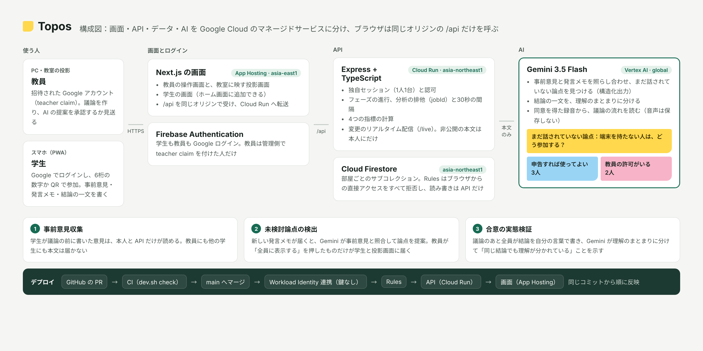

# T167 AI協調型グループディスカッション支援

> 2026-11-06 MVP仕様変更：全員Googleログイン・共通ホーム。固定の教師/生徒ロールとteacher claimによるHost制限を廃止し、議論のmembers.roleでHost/Participantを判定します。ログイン上限は全員1台です。新仕様・API・移行条件は [MVPロール設計](docs/mvp-roles.md) を参照。以下の旧仕様と相違する場合は新仕様を適用します。
>
> 議論の流れは1本にまとめている（Docs「UIフィードバック」）。教員はテーマ（必須）とクラス名（任意）だけでセッションを作る。参加者は表示名を登録し、音声登録（任意）、非公開の事前意見を書いて待つ。教員の開始後は録音しながら話し合い、発言メモを共有し、教員が承認した未検討の論点の問いかけを受け取る。教員の終了後に全員が結論の一文を書き、合意のずれ・4つの指標・録音の振り返りが結果に出る。グループはサーバーが決め（1グループ100人まで）、討論の時間は設定せず、セッションは作成から3時間で閉じる。


**「全員賛成」の中身のずれを、議論が終わる前に見つける。**

<!-- 提出前に記入：作品の URL とデモ動画を、次の行の先頭に [作品](URL) · [デモ動画](URL) · として足す。構成図の画像は docs/architecture.png。この README には確かめた状態だけを書く -->
[アーキテクチャ](#アーキテクチャ) · [Gemini の役割](#gemini-の役割) · [技術の選定理由](#技術の選定理由と制約) · [テスト](#テスト) · [開発に参加する](#開発に参加する) · [チーム](#チーム)

議論の前に全員の意見を非公開で集め、Gemini が「まだ議論されていない論点」と「合意の中身のずれ」を見つけて司会者に知らせる Web アプリ。司会者は AI の提案を承認してから全員に示すので、議論の主導権は人に残る。DevFest Hackathon 2026 の教育カテゴリの作品で、Google Cloud の Gemini（Vertex AI）・Cloud Firestore・Cloud Run・Firebase App Hosting・Firebase Authentication で動かす。

## 課題と3つの機能

大学のゼミやグループ学習では、発言が一部の人に偏り、少数意見が埋もれ、合意したつもりでも中身がずれていることがある。既存の会議 AI は発言の記録と要約が中心で、**発言されなかった意見**と**合意のずれ**は拾えない。

| 機能 | すること |
|---|---|
| 事前意見収集 | 議論の前に、全員の意見を非公開で集める。司会者も他の参加者も本文を読めない |
| 未検討論点の検出 | 事前意見と実際の議論を Gemini で照合し、まだ取り上げられていない論点を司会者に提案する。承認したものだけ全員に表示する |
| 合意の実態検証 | 結論が出たときに各自が合意内容を一文で書き、Gemini がずれを可視化する |

部屋は `collecting`（事前意見）→ `discussing`（議論）→ `consensus`（合意の確認）→ `closed` の順に、司会者が1つずつ進める。参加者はスマホで6桁の数字の参加コードを入れるか、アプリ内のカメラで QR コードを読み取り、Google ログインで参加する。QR の URL から開いた人は、ログインのあとにそのまま参加する。部屋を作った人が司会者（Host）になる。議論中、参加者は出た発言を短くメモで共有し、Gemini はこのメモと事前意見を照らし合わせる。スマホのホーム画面に追加すると、ブラウザの枠なしで開ける（PWA）。

## アーキテクチャ

<!-- 提出前に構成図を docs/architecture.png に置き、次の行の先頭と末尾のコメントを外す -->
<!--  -->

画面・API・データを Google Cloud のマネージドサービスに分け、ブラウザからは同じオリジンの `/api`（JSONと認可済みの変更配信）だけを使う構成。サーバーは使わない時間に0台まで縮む。

```
議論の流れ
  web/        Next.js（Firebase App Hosting · asia-east1）。/api を同じオリジンで受けて Cloud Run へ転送
  → api/      Express + TypeScript（Cloud Run · asia-northeast1）。認可、フェーズ、分析の排他、指標の計算
    → Gemini  gemini-3.5-flash（Vertex AI · global）。論点の抽出と照合、合意文のまとめ（構造化出力）
    → Firestore（asia-northeast1）。部屋ごとのサブコレクション

リアルタイム更新
  ブラウザ → /api/rooms/{部屋}/live → Cloud Run → Firestore を購読
  （Firestore/Storage Rulesはクライアントを全拒否し、APIが独自セッションと認可を検査）

デプロイ
  PR → CI（bash scripts/dev.sh check）→ main に squash merge
  → Variables の検査 → 鍵なしの認証（Workload Identity 連携）
  → Firestore/Storage Rules → API（Cloud Run）→ 画面（App Hosting）を同じコミットから順に反映
```

| 部分 | 実行場所 | Gemini に送るもの |
|---|---|---|
| 画面 | Firebase App Hosting（asia-east1。東京は非対応） | — |
| API | Cloud Run（asia-northeast1）。使わない時間は0台 | 部屋の事前意見・発言・合意文の本文、同意を得たグループの議論の録音（持ち主の ID は送らない。録音は保存しない） |
| Gemini | Vertex AI の global エンドポイント（[処理場所](#送るデータと処理場所)） | — |
| データ | Cloud Firestore（asia-northeast1） | — |
| ログイン | Firebase Authentication（生徒・司会者とも Google。教師権限は管理側で設定） | — |

### 設計の要点

- 非公開の事前意見は、本人と API だけが読める。Rulesは直接アクセスを拒否し、APIが本人を確かめる。API は Admin SDK を使うので Rules を通らないため
- 司会者と他の参加者に届くのは、API が持ち主を伏せて要約した論点だけにする。少数意見を出しやすくするため
- AI の提案は司会者が承認してから全員に表示する。Gemini の出力は毎回少し変わり、誤りもあるため
- Gemini には本文だけを送り、保存と API は東京に置く。Gemini の接続先は global で、処理場所が日本に限られないため
- ブラウザは常に同じオリジンの `/api` を呼ぶ。CORS の設定と、画面と API の URL の食い違いをなくすため
- Rules・API・画面を同じコミットから順に反映し、戻すときも3つをそろえて戻す。新しい画面と古い API が食い違わないため
- GitHub から GCP へは鍵を使わずに認証し、リポジトリに秘密情報を置かない。開発用リポジトリも提出用リポジトリも公開されているため

### API と認可

health以外は有効なGoogle IDトークンとアプリセッションCookieの両方が必要（セッション作成はfresh Google本人認証から行う）。学校管理者は署名済みのschoolAdmin/schoolId claimsで判定する。追加APIの全仕様は[認証とセッション](docs/auth-sessions.md#api-同一オリジン-api-経由)を参照。

画面は下のパスに`/api`を付けて呼ぶ。公開確認URLの`/api/healthz`は、Next.jsがCloud Runの`/health`へ転送する。`/api/health`も使える。Cloud Runの予約パスを避け、API自身のJSONを確認するため。`gemini: "gemini"`は接続設定を示し、生成の成功を保証するものではない。

| エンドポイント | ログイン | 部屋の所属 | 司会者 | フェーズ |
|---|---|---|---|---|
| `GET /health` | 不要 | — | — | — |
| `POST /sessions` / `POST /sessions/unlock` | fresh Google | 本人 | — | Cookie発行/回転、同時ログイン上限 |
| `GET /sessions/current` / `GET /sessions` | Google＋独自セッション | 本人 | — | 取得では利用期限を延長しない |
| `POST /sessions/activity` / `shared-device` / `revoke` / `logout` / `logout-all` | Google＋独自セッション | 本人 | — | ロック/期限/授業終了・本人の端末だけ |
| `GET /rooms/{部屋}/live` / `me` | Google＋独自セッション | 必要 | 内容に応じて必要 | 非公開意見は本人、結果は自分のグループだけ |
| `POST /rooms/{部屋}/messages` | Google＋独自セッション | 必要 | — | 部屋が`discussing`、またはグループごとに進む部屋で自分のグループが議論中。本人名義 |
| `GET /rooms/{部屋}/speaker/config` | Google＋独自セッション | 必要 | — | モデル設定の確認 |
| `POST /rooms/{部屋}/speaker/start` / `{runId}/chunk` / `{runId}/stop` | Google＋独自セッション | 必要 | Participantの録音担当のみ | Host開始後・同意・登録済みの所属グループ。背景送信は利用期限を延長しない |
| `GET/PUT /schools/{学校}/security-policy` | Google＋独自セッション | 同校管理者claim | 必要 | policy値域を検査 |
| `POST /schools/{学校}/users/{利用者}/sessions/revoke` | Google＋独自セッション | 同校管理者claim | 必要 | 対象者も同校であることをサーバーで検査 |
| `POST /rooms` | Google | —（作成者が司会者になる） | — | テーマと任意のクラス名（`className`）。時間（`minutes`）は任意。作成から3時間後の `expiresAt` を書き、過ぎたセッションは書き込みを `409 room_expired` で断る |
| `POST /rooms/join` | Google | —（参加コードで部屋を特定） | — | 新しい参加は `closed`・失効以外で、議論の開始前だけ。1本化した流れでは、グループをサーバーが決める（1グループ100人まで。超えたら次のグループを作る）。参加済みの人は開始後・終了後も同じコードで戻れる（外された参加者は `403`） |
| `POST /rooms/{部屋}/phase` | 必要 | 必要 | 必要 | 1つずつ順に進める。1本化した流れの開始には、全参加者の表示名の登録と所属が必要（音声登録は任意）。未準備がいれば`409 guests_not_ready`（人数 `notReady`）。`excludeNotReady: true`で未準備の参加者を外して開始し、外した参加者は以後この部屋に入れない。時間が設定されていなければ終了時刻を付けない |
| `POST /rooms/{部屋}/analyze` | 必要 | 必要 | 必要 | `collecting`・`discussing`（授業中） |
| `POST /rooms/{部屋}/progress` | 必要 | 必要 | 必要 | — |
| `POST /rooms/{部屋}/groups/choose` | 必要 | 必要 | 生徒のみ | 選ぶグループと今のグループが議論を始める前 |
| `POST /rooms/{部屋}/opinion` | 必要 | 必要 | 生徒のみ | 自分のグループが議論を始める前 |
| `POST /rooms/{部屋}/groups/start` | 必要 | 必要 | 必要 | `closed` 以外 |
| `POST /rooms/{部屋}/groups/end` | 必要 | 必要 | 生徒のみ | `closed` 以外で、自分のグループが議論中 |
| `POST /rooms/{部屋}/groups/recording` | 必要 | 必要 | 生徒のみ（録音への同意 `consent=1` が必要） | `closed` 以外で、自分のグループが議論中か、議論を終えたあと。録音しない部屋（`recording: false`）では `403` |
| `POST /rooms/{部屋}/statement` | 必要 | 必要 | 生徒のみ | `closed` 以外で、自分のグループが議論を終えたあと、または `consensus`。分析中・結果確定後は不可 |
| `POST /rooms/{部屋}/groups/analyze` | 必要 | 必要 | 生徒は自分のグループ（全員そろったときだけ）、司会者は任意のグループ | `closed` 以外 |
| `POST /rooms/{部屋}/insights/{提案}/approve` | 必要 | 必要 | 必要 | `closed` 以外。承認した部屋全体の提案は全参加者へ、グループの提案はそのグループへ配信する |
| `POST /rooms/{部屋}/consensus/analyze` | 必要 | 必要 | 必要 | `consensus` |

部屋の作成では `groups`（1〜12、既定は 1）でクラス内のグループの数を決める。グループが1つなら参加と同時にグループ1に入り、複数なら参加のあとに生徒が自分で選ぶ（`groups/choose`）。グループは先生が一斉に開くのではなく、それぞれのペースで進む：グループ全員の事前意見（`opinion`）がそろうと議論が始まり、生徒のだれかが議論を終える（`groups/end`）と結論の一文（`statement`）に進み、全員の一文がそろうとそのグループだけを分析して `results/group-{番号}` に保存する。休みの人がいるときは、先生が今いるメンバーで始める（`groups/start`）か、今ある回答で結果を出せる（`groups/analyze`）。グループの状態と人数は部屋ドキュメントの `groupState` に入り、本文は含めない。グループの結果の分析は、Gemini の呼び出しを増やしすぎないよう、結果が出たグループは生徒の操作では分析し直さず（先生だけが出し直せる）、グループごとに同時に1つだけ（`jobId` で古い結果を捨てる）、出し直しは前の分析から30秒あける。`progress` は件数だけを返し、本文は返さない。

参加・グループ移動・意見提出・開始/終了の状態確認と更新はトランザクションで行う。議論開始後の新規参加（1グループの部屋）や移動は受け付けず、既存メンバーの再参加は維持する。意見・結論・発言の読み書きは独自セッションを検査するAPIへ集約し、直接アクセスはRulesが拒否する。`closed`では回答・録音・グループ操作・分析を受け付けず、実行中だった分析の結果も書き戻さない。

議論の録音はグループで1台（チームドキュメント「仕様」F03）。先生は部屋の作成で録音するか（`recording`、既定は録音する）を決め、生徒はグループ全員の同意を画面で確かめてから録音を始める。議論が終わると、録音している端末が音声（30分・12MBまで）を `groups/recording` に送り、API が Gemini で議論の流れ・よかった場面・見直したい場面・先生向けの提案を出して `results/flow-g{番号}` に保存する。音声は保存しない。分析はグループごとに1回で、分析中や別の録音の追加送信は `409`（完了済みの同じ録音の再送は保存済みの受領結果を返し、再分析しない）、Gemini の失敗は `503` を返し、画面は端末に残した録音を送り直せる。Gemini の費用を抑えるため、送り直しは失敗から30秒あけ、分析はグループごとに3回まで（`429`）。結果は、チームドキュメント「タブ 14」に合わせて、グループの結果（`results/group-{番号}`・`results/flow-g{番号}`）はそのグループのメンバーと先生だけが、クラス全体の結果（`summary`・`coverage`）は先生だけが読める（API配信の認可）。

エラーは `401`（未ログイン）・`403`（所属・役割が違う）・`404`（参加コードや部屋がない）・`409`（フェーズ違い・分析中・処理済み）・`413`（録音が長すぎる・大きすぎる）・`415`（録音の形式）・`429`（30秒以内の再分析・録音の分析の回数の上限）・`503`（Gemini の失敗）で返し、本文は `{ "error": { "code", "message" } }` の形にそろえる。

### 結果の整合性

| 仕組み | 防ぐこと |
|---|---|
| 未検討論点（`analysis`）・部屋全体の合意（`consensusAnalysis`）・グループ別の分析開始時に、トランザクションで jobId と開始時刻を書く | Cloud Run が複数台になったときの分析の二重実行 |
| 結果の保存時に jobId を照合し、一致しなければ捨てる | 遅れて返った古い分析が新しい結果を上書きすること |
| 未検討論点・部屋全体の合意・グループ別の各分析は30秒以内の再実行を制限する（手動の再実行は`429`と残り秒数） | Gemini の費用の急増と、画面の連打 |
| 合意の分析で番号の範囲外・重複は捨て、どのまとまりにも入らなかった一文は1つずつ別のまとまりにする。存在しない提案 ID は捨てる | temperature 0 で同じ入力のまま失敗し続けることと、一致度を高く見せること |
| 書き込みは決められたフェーズで本人名義だけ（API、直接アクセスはRulesで拒否） | 他人へのなりすましと、締め切ったフェーズへの書き込み |
| Gemini が失敗しても発言と意見は認可済みAPIで保存する | AI の障害で議論が止まること |
| 接続先・モデル・Variables が空なら、起動とデプロイの前に止まる | 設定漏れのまま本番に出て、分析だけが失敗し続けること |

## Gemini の役割

Gemini が担うのは、文章の意味を比べる2つの判定と、グループの議論の録音の分析。数える・割合を出す・誰に見せるかを決めるのは API と Rules。未検討論点の提案は司会者の承認を経てから全員に届く。合意の分析結果と録音の分析は承認を挟まず、グループの分はそのグループのメンバーと先生が、クラス全体の分は先生が読める。

```
未検討論点の検出（議論中に司会者が実行）
  事前意見の本文 + 議論の発言（参加者が共有した発言メモ）
  → Gemini：論点を最大10個取り出し、それぞれ議論で取り上げられたかを判定
  → API で型・件数・長さを検証 → 未検討の論点を「承認待ち」で保存
  → 司会者が承認 → 参加者の画面にも表示

合意の実態検証（合意フェーズで司会者が実行）
  各自の合意の一文 + 承認済みの提案 + 承認後の発言
  → Gemini：意味が同じ一文をまとめ、承認後に取り上げられた提案を判定
  → API で番号の欠け・重複を直し、まとまりと4つの指標を保存（承認は挟まず、先生が読める。グループごとの結果は、そのグループのメンバーも読める）

議論の録音の分析（グループが議論を終えたとき、録音した端末が送る）
  グループ全員が同意した録音（最長30分）+ テーマ
  → Gemini：話題ごとの時間、よかった場面・見直したい場面（時刻つき）、質問・応答・根拠・協働の場面、先生向けの提案
  → API で型・件数・時刻の形を検証して results/flow-g{番号} に保存（音声は保存しない）
```

録音の分析では、チームドキュメント「仕様」F04 の出力ルールを指示に入れる：事実と解釈を分け、推測で補わない。話者を特定せず、人格や能力を推定しない。改善点は次にとれる行動で書き、成績はつけない。録音から議論を聞き取れなければ、そう返す（`speechDetected: false`）。

- 応答は構造化出力（`responseSchema`）で JSON として受け、API が zod で型・件数・長さを検証する。形が崩れた応答は保存せず `503` にする
- `temperature` は 0。同じ議論から毎回違う提案が出るのを抑えるため
- 思考レベルは `LOW`。論点の判定と一文のまとめに深い推論は要らず、思考に使ったトークンも出力として課金されるため（[CONTRIBUTING](CONTRIBUTING.md#gemini-のモデルと費用)）
- 1回の呼び出しは20秒（録音の分析は180秒）で打ち切る。分析中の再実行は `409`、30秒以内の再実行は `429` と残り秒数を返す
- 保存する結果には、本物の Gemini かモックかを記録する。デモデータと実測を取り違えないため

### 送るデータと処理場所

| 送るもの | 送らないもの |
|---|---|
| 事前意見・発言・合意の一文の本文、承認済みの提案の要約、同意を得たグループの議論の録音とテーマ | 参加者の ID・名前・メールアドレス、参加コード |

Gemini は Vertex AI の **global エンドポイント**で呼ぶ。`gemini-3.5-flash` の通常の従量課金（Standard PayGo）は global と米国・欧州のマルチリージョンだけで提供され、東京（asia-northeast1）は専用の容量契約（Provisioned Throughput）に限られるため（[モデル情報](https://docs.cloud.google.com/gemini-enterprise-agent-platform/models/gemini/3-5-flash)、2026-11-05 に確認）。

global では、リクエストがどのリージョンで処理されるかが決まらない（[データの扱い](https://docs.cloud.google.com/vertex-ai/generative-ai/docs/data-governance)）。そのため Gemini に送るのは判定に要る本文と録音だけにし、意見・発言・結果の保存（Firestore）と API は東京に置く。録音は API のメモリ上で Gemini に渡すだけで、Firestore にも Cloud Storage にも保存しない。Google は、利用者の許可なくこのデータをモデルの学習や調整に使わない。

応答を速くするため、Vertex AI は既定でプロンプトをキャッシュする。メモリ上と、暗号化された保存領域（durable。このプロジェクトでも既定のまま有効）の2段で、どちらも書き込みから24時間以内に消え、学習には使われない。global ではキャッシュも、どのリージョンに置かれるかが決まらない。また Google は、不正利用の検出のためにプロンプトを記録することがある（[データの保持](https://docs.cloud.google.com/gemini-enterprise-agent-platform/resources/zero-data-retention#implicit_data_caching)、2026-11-05 に確認）。

## 4つの指標

指標は API が保存データから計算する（[`api/src/metrics.ts`](api/src/metrics.ts)）。Gemini の判定を使う値には「Gemini による推定」と表示し、モックで動かしたときは「デモデータ」と表示して、実測の改善効果とは区別する。

| 指標 | 計算方法 | データがないとき |
|---|---|---|
| 意見の反映率 | 事前意見の論点のうち、議論で取り上げられた割合 | 事前意見が0件なら「データなし」 |
| 認識一致度 | 合意の一文を意味でまとめたとき、最も大きなまとまりに入った人の割合 | 回答が2人未満なら「データなし」 |
| 参加の公平性 | 1 −（参加者ごとの発言数のジニ係数）。全員同じ数なら 100% | 参加者2人未満、または発言0件なら「データなし」 |
| 介入の有効率 | 承認した提案のうち、承認後の発言で取り上げられた割合 | 承認した提案が0件なら「データなし」 |

## 技術の選定理由と制約

| 技術 | 選んだ理由 | 欠点・制約 | 対策 |
|---|---|---|---|
| Gemini（Vertex AI） | 日本語の議論から論点を取り出し、意味の近さで文をまとめられる。構造化出力で JSON を直接受け取れる。Cloud Run のサービスアカウントの権限で呼べ、API キーが要らない | 応答に数秒かかる。出力が毎回少し変わる。費用がかかる。東京では通常の従量課金がない | 提案は司会者の承認制。分析は1部屋30秒に1回まで。temperature 0、思考レベル LOW。接続先は global にし、送るのは本文だけ |
| Cloud Firestore | APIが変更を購読し、認可済みの変更だけを参加者へ届けられる。Rulesで直接アクセスを拒否できる | 結合ができない。Rules 内の get も読み取りとして課金される | 部屋単位のサブコレクションにする。Rules はエミュレータで自動テストする |
| Cloud Run | Gemini の呼び出しや集計など、クライアントに置けない処理を動かせる。使わない時間は0台 | コールドスタートで最初の応答が遅い | デモの時間帯だけ最小インスタンスを1にする |
| Firebase App Hosting | Next.js をサーバー描画込みで公開でき、Firebase の Web 設定を自動で渡せる | 東京リージョンがない（台湾を使う） | データと API は東京に置く |
| Firebase Authentication | 生徒・司会者とも Google でログインし、教師権限は管理者が付与する | 教師claimの付与と失効は管理側の運用が必要 | 認証方式と教師claimをAPI・Rulesの両方で検査する |
| Workload Identity 連携 | GitHub Actions から鍵なしで GCP にデプロイできる。許可するのは開発用リポジトリだけ | 設定の値（Variables）が1つ欠けても気づきにくい | デプロイの最初に6つの Variables を確かめて止める。一覧の一致を回帰テストで確かめる |

## 同じ端末で複数の作業を動かす

`T167_TEST_PORT_OFFSET=20000 bash scripts/dev.sh check` で画面・API・Auth/Firestore等のポートをまとめてずらす。検査用DBは `demo-t167-test-20000` になり、通常のプレビューから分離する。0〜40000の整数を指定でき、既存ポートが使用中なら起動前に停止する。既存のサーバーを検査に流用しない。通常の起動にも `T167_TEST_PORT_OFFSET=10000 bash scripts/dev.sh serve` を使える。並行する作業では異なる値を指定する。検査用コピーを作らず、対象ブランチのまま全検査を実行できる。macOSのBash・awkでもPR本文の生成と構成検査が動くようにしている。


## 依存ライブラリの管理

Node.jsは22.12以上の22系を使う（`.nvmrc`は22）。Vitest 5の実行要件に合わせ、APIとwebの`engines`にも最低版を記載する。

| 対象 | 固定版・対応 |
|---|---|
| Firebase Admin | API・エミュレータ用ツールを14.5.0に統一 |
| Zod | 4.6.7。型の共通制約を`ZodType`に更新し、入力制約と変換結果を回帰検査 |
| Vitest | API・webとも5.1.0。webのNode型定義も22系に統一 |
| 間接依存 | `overrides`で修正版を固定。grpc-js 1.14.7、postcss 8.5.32、OpenTelemetry core 2.8.0、uuid 11.1.1、glob 14.0.4、影響範囲のminimatch 11.0.5 |

依存を変更するときはpackage.jsonとlockfileを同時に更新し、`npm ci`、`npm audit`（開発依存も含む）、`bash scripts/dev.sh check`で確認する。`npm audit fix --force`は使わず、必要な互換修正を確認する。auditの0件は実行時点で把握されているアドバイザリの結果で、脆弱性が存在しない保証ではない。

この依存更新には、新しい音声解析ライブラリ、認証方針・API仕様・Rules・モデル・画面の変更を含めない。実Google Cloudへの接続、CLIのデプロイ操作、iPad実機は別途確認する。


## ログインと参加の入口

Googleログイン後はホームを開き、「参加する」から6桁の数字か QR で参加する。教員と学生の分岐はなく、教員はホームの「ディスカッションを作る（教員）」から作成する。タブはホーム・参加・アカウントの3つで、使い方とプライバシーはログイン画面と「アカウント」から開く。ログイン前の入口には参加リンクを表示せず、ホーム・参加・登録・教師画面・部屋への直接アクセスもログイン画面へ戻す。ログアウト後の戻る・再読み込みでも同じ制御を行う。プライバシー説明だけはログイン前にも読めるが、ホーム等のタブは表示しない。QRの6文字コードは同じタブで保持し、ログイン後のホームから参加を開いた時に入力済みにする。APIとRulesの認可は引き続き独立して検査する。

## テスト

`web`の`typecheck`はアプリとE2Eを別の設定で検査する。App Hostingのアプリビルドには`web/`外のエミュレータ用補助ファイルを含めず、E2Eの型検査はリポジトリ全体を取得するCIで実施する。

`bash scripts/dev.sh check` が、CI と同じ次の検査を実行する。PR と `main` への push のたびに GitHub Actions が実行し、同じ検査を手元でも実行できる（実行環境による差は別途確認する）。

| 検査 | 件数 | 内容 |
|---|---|---|
| lint・型・ビルド | — | web と api |
| 単体テスト | web 22・api 61 | 表示の整形、4つの指標の計算、起動時の環境変数（空・未設定で止まる）、Gemini への生成の設定（思考レベル LOW）、録音の分析の出力の切り詰めと時刻の形 |
| Rules | 14 | 生徒・教師・学校管理者・失効/refresh想定・匿名・未ログインすべてについて、FirestoreとStorageの直接読み書き/一覧を拒否 |
| API の結合 | 107（実モデルの1件は既定で省略） | エンドポイントごとの認可（`401`・`403`）、フェーズ（`409`）、分析の排他と30秒制限（`409`・`429`）、Gemini の失敗（`503`）、グループごとの進行と結果、録音の同意・形式・長さ・大きさ・1回だけの分析・30秒あけた再送・3回までの上限、本文をログ/エラーへ出さないこと、同時移動/開始、終了後の送信と結果保存の拒否、合意分析の排他と期限切れ後の古い結果の破棄 |
| E2E | 33 | スマホ幅で、教員の作成画面から1本の流れの通し（事前意見 → 開始 → 発言メモ → 未検討論点の提案と承認 → 終了 → 結論の一文 → 理解のずれと指標。意見と一文の本文が教員に出ないこと）、MVPフローで未準備のGuestを外して開始し同意を取り消した録音を送らないこと、参加コードからの参加と非公開意見の提出、QR の URL からログイン後にそのまま参加、アプリ内カメラでの QR の読み取り（擬似カメラ）、数字だけの入力、誤ったコードのエラー、ホーム・参加・使い方・設定の画面が横にはみ出さないことと下のタブメニュー（先生・生徒のタブ、いまの画面の表示、高さ 44px 以上）、録音の同意から分析の結果まで（擬似マイク）、先生の Google ログイン（エミュレータ）から部屋の作成・未検討の論点の提案と承認（意見の本文が先生に出ないこと）、分析の失敗（`503`）と途中で止まった分析の期限切れのあとのやり直し、ホーム画面に追加するためのマニフェストとアイコン（PWA） |
| 提出スクリプト | 16 | 秘密情報の検出と、検査前に提出先を変えないこと |
| 開発の入口 | 26 | CI の変更判定（9）、`dev.sh pr` の PR 作成と承諾前の auto-merge の防止（13）、`serve` を停止するときの子プロセスの終了（2）、不正オフセット・既存サーバー保護（2） |
| 設定の受け渡し | 35 | GitHub の Variables の一覧の一致とデプロイ前の検査、API が受け取る環境変数、クラウドのログインのプロジェクト、gcloud・ADC がないときの案内、プレビューとメンバーの権限の設定 |
| Rulesの配備 | 8 | Firebase登録バケットの全ページ取得、登録なし、権限・通信・応答異常時の停止、計画モード、一時設定の削除。実クラウドへ配備しない |

品質検査の契約・制限・旧形式との互換性は [backend-contract](docs/backend-contract.md) を参照。`T167_TEST_PORT_OFFSET=10000 bash scripts/dev.sh check` で既存プレビューとポート・DB名を分離する。使用中のポートは拒否し、他のサーバーを再利用しない。

APIカバレッジ（行/文85・分岐80・関数90%以上）、進行規則5件の変異検査、30人・6グループの同時提出3回もcheckに含む。負荷のp95目標は1秒で、測定結果を出力する。本番速度を保証する測定ではない。

Rules・API の結合・E2E は、Auth・Firestore・StorageのエミュレータとGeminiのモックで動かす。GCP の認証情報は使わない。

<!-- 提出前に記入：本番の URL での通しテスト（司会者1人＋参加者3人）と手動テスト（機内モードからの復帰、再読み込みでの再参加）の結果 -->

## ディレクトリ構成

| ディレクトリ | 内容 |
|---|---|
| [`web`](web) | 画面（Next.js）。先生の Google ログイン・部屋の作成・ダッシュボード、生徒の参加コードでの参加・非公開意見・録音・結論の一文・振り返り、`/api` の転送、E2E（Playwright） |
| [`api`](api) | API（Express + TypeScript）。認可、フェーズ、Gemini（Vertex AI とモック）、4つの指標、起動時の設定、結合テスト |
| [`firebase`](firebase) | Firestore Rules とそのテスト、ローカル用のテストデータ、固定版の Firebase CLI |
| [`infra`](infra) | 共通の変数（`env.sh`）と、GCP・GitHub の構築スクリプト |
| [`scripts`](scripts) | 開発の入口 `dev.sh`、CI の変更判定、提出スクリプト、クラウドの AI ツールのログイン |
| [`tests`](tests) | 提出スクリプト・CI の変更判定・`dev.sh pr`・設定の受け渡しの回帰テスト |
| [`.github`](.github) | CI・デプロイのワークフローと PR テンプレート |
| [`docs`](docs) | 認証情報の扱い、構築の引き継ぎ、構築手順書の写し |

## 開発に参加する

クラウドのデモは既存のApp Hosting・Cloud Run・Firebase認証・Firestore・Vertex AIを使う。Macやローカル証明書は利用者に不要。トークン失効確認用の実行権限、同じ版での反映と実機/実APIの確認は[クラウドデモ手順](docs/cloud-demo.md)に従う。PRだけではクラウドへ反映されない。

招待を受けて clone すれば、秘密情報なしで動かせる。Auth と Firestore はエミュレータ、Gemini はモックで動き、GCP には接続しない。

```bash
bash scripts/dev.sh setup    # 依存を lockfile どおりに入れる
bash scripts/dev.sh serve    # エミュレータ・テストデータ・API・画面をまとめて起動
```

http://localhost:3000 を開き、参加コード `100001` で参加する。 終了は起動したターミナルで `Ctrl+C`。エミュレータ・API・画面をまとめて停止する。

| 環境 | 必要なもの | セットアップ |
|---|---|---|
| ローカル | Node.js 22、Java 21（Firestore エミュレータ用）。Windows は WSL | `bash scripts/dev.sh setup` |
| Dev Container・Codespaces | VS Code（Codespaces もブラウザ版ではなく VS Code から開く） | `.devcontainer` が自動で行う |
| クラウドの AI ツール | — | Claude Code は `bash .claude/cloud-setup.sh`、Codex は `bash .codex/setup.sh` |

PR の前に `bash scripts/dev.sh check` で CI と同じ検査を通し、`bash scripts/dev.sh pr --no-merge` で検査・push・PR の作成を1回で行う。`main` へのマージから自動デプロイまで（本番反映）は、Yuto Matsui の承諾を得てから行う（[PR の確認から本番反映までの手順](docs/contributor-preview-guide.md)）。本物の Gemini で試すときは `GEMINI_MOCK=0 bash scripts/dev.sh serve`（gcloud と ADC が要る。[CONTRIBUTING](CONTRIBUTING.md#起動する)）。

開発の流れと Git・CI のルールは [CONTRIBUTING](CONTRIBUTING.md)、AI エージェントへの指示は [AGENTS.md](AGENTS.md)、認証情報の扱いは [docs/credentials.md](docs/credentials.md) にある。

## チーム

DevFest Hackathon 2026 チーム167。

| メンバー | 役割 |
|---|---|
| Yuto | プロジェクトマネージャー・インフラエンジニア |
| Ryota | プロダクトマネージャー・バックエンドエンジニア |
| Koyuri | UX/UI デザイナー・フロントエンドエンジニア |

## ライセンス

[MIT License](LICENSE)

## 認証・セッション管理

Google本人認証とアプリ独自のHttpOnly Cookieを組み合わせ、Cloud Runで毎回検査する。7日間の未利用で失効し、全員共通で既定1台まで。上限を超えると最終利用が古い端末から失効する。共用端末は15分の無操作で再認証を要求し、設定した授業終了時刻に失効する。取得・自動トークン更新・バックグラウンド通信は期限を延ばさない。

`/sessions` で個別/全端末ログアウト、共用設定、保管した音声の再生/再送を行う。学校管理者claimとschoolIdがある本人だけ学校ポリシーと同校利用者の失効を操作できる。画面の役割選択で権限を付けない。

Firestoreの直接購読は認可済みAPI配信へ移行し、Firestore/StorageのクライアントRulesは拒否する。既存APIの非公開意見/所属/Host/グループ認可は維持する。録音は15秒ごとにIndexedDBへ保存し、認証失効では停止・保存後に画面を閉じる。各チャンクを単体再生できるとは仮定しない。端末のOS停止・容量不足は残るため、実機検査が必要。

設計・モデル・API・セキュリティ判断・移行/運用は [認証とセッション](docs/auth-sessions.md)。`scripts/dev.sh check` はStorageエミュレータも使用し、ポート9199も指定オフセットで分離する。実API/クラウド/IAMを変更するテストは含まない。既定でクラウドへ適用しないTTL準備は `bash infra/setup-session-security.sh --plan`。Rules変更により旧画面との互換性が切れるため、本番は承認されたメンテナンス時間に同一SHAで切り替える。依頼者の確認後にPRとして公開する。PR作成は本番反映の承諾ではなく、マージ・auto-merge・本番反映には別途承諾が必要。

Storage Rulesは本番デプロイとロールバックの両方でFirestore Rulesと同じコミットから、Firebaseに登録されたバケットへ適用する。登録がないと確認できた場合だけStorageを省略し、新しいバケットは作らない。一覧の権限・通信エラーでは配備を停止する。Storage Rulesだけの変更にも別メンバーレビューを要求し、`pr --approved`による自動マージ設定は行わない。配備対象とレビュー抑止の回帰テストはクラウドへ接続せず実行する。

### 登録した声を使うリアルタイム話者識別

録音と同じマイクから1秒区間を送り、所属グループの登録音声と照合して発話時間を集計する。Hostは全班を確認でき、Guestへの表示はHostの明示許可が必要。推定値であり、能力・意欲の評価には使わない。

`bash scripts/dev.sh speaker-setup`で固定版Python依存とモデルを準備し、`SPEAKER_TEST_VOICES=合成WAVの絶対パス1,絶対パス2 T167_TEST_PORT_OFFSET=33000 bash scripts/dev.sh speaker-check`で実モデルを検証する。通常の`check`はモックで認可・画面を検査し、実モデル試験は別実行する。モデル設定を渡して`serve`を起動するとDB/Auth/Geminiはローカルのまま実モデルを使える。合成音声の生成・検証・制約は[MVPロール設計](docs/mvp-roles.md)を参照。Google文字起こしAPI、クラウド設定、本番デプロイは変更しない。

本番APIの`api/Dockerfile`もPython・固定版の推論依存・SHA-256検証済みモデルを同梱する。ビルドはリポジトリのルートから`docker build -f api/Dockerfile -t <検証用イメージ名> .`。API専用の`Dockerfile.dockerignore`で送信ソースを限定し、端末内音声・認証情報・デモ用Webを含めない。配備設定は2 CPU・2GiB・同時8リクエスト・0〜2台。実コンテナのビルド・Cloud Run上のモデル起動と6グループ同時処理は自動checkに含まれず、配備前に別途確認する。構成の回帰検査3件はcheckで実行する。

### PR用の実APIデモ

画面・API・実話者モデルを同梱し、非本番web-previewの専用タグで実Geminiを使う構成は`demo/`。`demo/deploy.sh --plan`で対象を確認し、依頼者が非本番への反映を許可したときだけapplyする。通常のCI/checkではクラウドを変更しない。データはDEMO_ID専用領域に分離する。[起動・認証・制約](docs/cloud-demo.md)を参照。

APIの正常応答を待ってからNextを起動し、初回ログイン時の転送先不在を防ぐ。APIが起動しなければ有限回で失敗し、子プロセスを停止する。起動順の回帰検査3件は通信をモック化してcheckで実行する。`demo/`の構築変更も追加レビューの対象とし、`pr --approved`では自動マージを設定しない。
