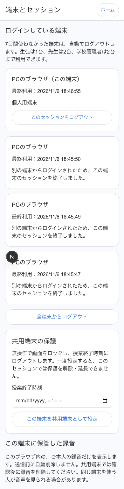

# 認証とアプリセッション

## 設計と既存構成

Next.js → 同一オリジン `/api` の転送 → Express/TypeScript (Cloud Run) → Firebase Admin SDKを維持する。FastAPIは導入しない。FirebaseのGoogle本人認証を置換せず、全保護APIで失効確認付きIDトークンと独自Cookieの両方を検査する。学校・権限は管理者が設定した `schoolId` / `schoolAdmin` / `teacher` claimsのみを信頼する。UIの役割選択は認可情報に使わない。

Docs正本の匿名参加記述と現在のGoogle必須方針は異なる。依頼者の全員Googleログイン必須の指示を優先する。既存未マージの依存更新・品質・クラウド準備・ログイン必須化 (#26/27/28/30/31) を前提とする。依頼者の確認後にPRを公開する。マージ・auto-merge・本番反映は別途承諾まで行わない。

## 判断

- 7日=168時間。UTCのサーバー時刻。GET/ストリーム/トークン更新は延長しない。成功した業務操作・ユーザー操作によるactivityだけが更新する。ブラウザで信頼されたキー/ポインター操作をまとめて送る。サーバーは認証・セッション・上限を検査するが、改造クライアントが本物の人間操作を行ったかを証明することはできない。
- 1/2/2台、最終利用が古い順、同時刻は作成時刻・IDで決定。ユーザーごとの制御文書を全作成/失効トランザクションで共有する。
- 生の256-bit乱数はHttpOnly Cookieだけ。文書IDと一覧IDはSHA-256。クライアント指定IDで作成しない。UIDは検証済みトークンからのみ取得。CookieとUIDを両方照合。
- 本番は `__Host-discuss_session; HttpOnly; Secure; SameSite=Strict; Path=/`。Domainなし。Max-Ageは残り有効期限。両エミュレータが有効なローカルだけ別名の非Secure Cookie。同じCookieでも別ユーザーのIDトークンとは組み合わせられない。
- 全保護APIにFirebase Bearerが必須なのでCookieだけではCSRFが成立しない。cross-site Fetch Metadataも拒否しCORSを開かない。作成/解除には5分以内のGoogle再認証を要求し、解除時にCookieを回転する。
- 既存Firestore直接購読はCloud Runの認可済みライブ配信へ移す。部屋ごとにブラウザ内で1接続を共有し変更時だけ配信。取得は利用日時を延ばさない。失効は各APIと配信時および30秒以内の再検査で検出。Firestore/Storage Rulesはクライアントを全拒否。非公開意見は本人だけ、未承認提案/全体結果は教師だけ、グループ結果は同グループだけ。
- Storage/署名URLは現状未使用。今回も作成しない。将来発行時は同じセッション検査、単一オブジェクト/PUTだけ/短命(例60秒)/サイズと形式検査。発行済みURLは期限まで失効不可という残余リスクがある。
- 共用端末の15分ロックはサーバーでも検査。録音を継続する特権は付けず、ロック時は録音を停止して端末内保存を完了してから認証画面を出す。録音中の期限切れ/失効/通信断でもローカル音声を優先し、送信成功前に削除しない。
- 授業終了日時は共用端末設定時に指定しサーバーで強制。学校管理者の一括失効APIも用意する。MVPには学校ディレクトリ/時間割連携はなく、既存の部屋終了を学校全体の授業終了と同一視しない。
- 学校設定は一つのpolicyモジュールから参照。学校管理者は同校だけ変更/失効可能。新端末通知はインターフェースに分離し、MVPは配信しない。

## 保存モデル

`users/{uid}/sessions/{sha256(cookie)}`: sessionId,uid,schoolId,role,deviceLabel,deviceType,createdAt,lastActivityAt,expiresAt,revokedAt,revokeReason,isSharedDevice,userAgentSummary,lockedAt,classEndsAt,reauthenticatedAt,deleteAt。時刻はFirestore Timestamp。deleteAtは認証に使わず、期限後30日保持用TTL。
`users/{uid}/sessionControl/state`: activeIds (最大2)、監査用の一方向に乱数化したsubjectId。セッション一覧は本人の最新30件。
`schools/{schoolId}/security/policy`: idleDays,studentLimit,teacherLimit,adminLimit,sharedIdleMinutes,endAtClassEnd,newDeviceNotifications。値域はAPIで制限。
`securityEvents/{randomId}`: event,at,deleteAt,subjectId,reason。氏名/メール/uid/生のセッションID/端末ラベル/IP/UA/トークン/Cookie/音声/意見本文は記録しない。subjectIdはランダムで外部ログに出さない。ログは管理用Firestoreに30日保持、Rulesは拒否。閲覧は運用監査担当のIAMに限定する。既存Editor/Ownerは閲覧可能なため本番前に最小権限をレビューする。

## API (同一オリジン `/api` 経由)

`POST /sessions`: fresh Google token。端末表示名/type/shared/classEndsAt、201、Cookie設定。
`GET /sessions/current`: 有効性/ポリシー/ロック確認、延長なし。
`POST /sessions/activity`: 有効な操作の更新、ロック中不可。
`POST /sessions/unlock`: fresh Google token + 旧Cookie。本人確認しCookie回転。
`GET /sessions`: 本人の最新30件、安全な表示情報のみ。
`POST /sessions/revoke`: 一覧IDで本人の個別失効。
`POST /sessions/logout-all`: 本人の全端末失効。
`POST /sessions/logout`: 現端末失効、Cookie削除。
`POST /sessions/shared-device`: 共用設定/終了日時。
`GET/PUT /schools/:schoolId/security-policy`: 同校管理者だけ。
`POST /schools/:schoolId/users/:uid/sessions/revoke`: 同校管理者だけ、対象所属もサーバー取得で検査。
`GET /rooms/:roomId/live`: 認可済み部屋データの変更配信。送信直前にもセッション/所属を再確認。
`GET /rooms/:roomId/me`: 本人の所属のみ。

セッション失効は401 + reason、共用ロックは423。IDトークンの通常の期限エラーでのみ一度refresh、セッション失効で再作成しない。ネットワーク/5xxはログアウトせず再試行案内。権限失効時は保護画面を即時隠し、録音保存後Firebase signOutする。

## 運用・反映

ローカルはAuth/FirestoreエミュレータとGeminiモック、専用ポート/DBで検査。実API試験は別扱い。ユーザー確認後にだけPR、Rules/infra変更は別メンバーレビューとYuto Matsuiの本番反映承諾が必要。
反映前: securityEvents/sessionsのdeleteAt TTL、Storage RulesとバケットのIAM公開状態、学校claims、ログ閲覧権限を確認。今回クラウドには適用しない。新Rulesは旧フロントの直接購読を止めるため、通常のRules→API→Webだけでは一時停止がある。メンテナンス時間にWeb利用停止→同一SHAのRules/API/Web→再ログイン確認→利用再開。旧Rulesだけへ戻してセッション制御を迂回させない。ロールバックも保護境界を維持する。

Storage Rulesも`deploy.yml`から`node infra/deploy-rules.mjs --apply`でFirestore Rulesと同じコミットから配備する。[Firebase Storage登録バケット一覧API](https://firebase.google.com/docs/reference/rest/storage/rest/v1beta/projects.buckets/list)で全ページを読み、登録済みの各バケットへ明示的に適用する。登録がないことを確認できた場合だけStorageを省略し、ビルド用GCSバケットには適用しない。権限・通信・応答形式エラーでは配備を停止する。新規バケットは作成しない。既定の`--plan`は一覧の読み取りのみで変更しない。手動ロールバックは同じ工程を使用する。Storage Rulesだけの変更も`dev.sh pr`のレビュー対象とし、承諾後でも自動マージを設定しない。配備対象とレビュー抑止の両方を回帰テストで検査する。

管理者は対象バケットの有無・Rulesの適用先・バケットIAMの公開状態・既存利用への影響・デプロイ実行主体の権限を確認する。RulesはAdmin SDKやIAM経由のアクセスを制限しない。これらのクラウド操作はローカル検査に含めない。

配備前に管理者が`firebasestorage.googleapis.com`を有効にし、配備アカウントの`firebasestorage.buckets.list`とRules配備権限を確認する。`infra/setup-project.sh`にもAPIを追加したが、この作業では実行していない。API未有効の403を「バケットなし」と扱わない。

## 実機で確認する項目

iPad SafariのCookie/Google再認証、キーボード操作検知、IndexedDB容量/プライベートモード、30分録音、画面ロック・OSによるバックグラウンド停止、通信復旧。自動テストの擬似マイクや時間制御では実機挙動を保証しない。

## 確認項目と限界

- APIは独自セッション＋Firebase失効検査、トランザクション、本人/所属/教師/グループの認可を検査する。Secure Cookieは本番設定、非Secure例外は両エミュレータがloopbackの時だけ。Next.js越しの配信ではContent-Encoding: identityとno-transformを使い、圧縮の滞留を避ける。
- Auth/Firestore/StorageエミュレータとGeminiモックで、7日境界、成功操作/自動取得、refreshでの迂回、1/2/2台と並列競合、個別/全端末失効、同校管理者、CSRF Fetch Metadata、監査ログ内容、配信の非公開データと失効を検査する。
- Playwrightではセッション復元、別ブラウザによる失効、15分の共用ロック、擬似マイクの15秒保存、オフライン中の録音継続、失効→保存→ログアウト→再ログイン→再生、容量不足を検査する。ロックで保存を先行させる順序は単体テストでも検査する。
- 履歴は最新30件。TTLは遅延削除であり、検証には依存しない。Cookieを消してもサーバーで失効できたとは限らないため、ログアウト通信が失敗した時は成功と表示しない。
- ライブ配信は部屋ごと/ブラウザごとに1接続を共有する。変更時のセッション検査と、最大30秒ごとのトークン/セッション検査が追加コストとなる。サーバーへの取得で利用日時は延ばさず、非表示タブの定期確認も止める。Cloud Run再接続・アイドル課金・CDN挙動は実クラウドで測定が必要。
- 学校設定の同時ログイン上限を減らした場合、新規ログイン時に上限へ収束する。ロック/未利用/授業終了は各検証時に新しい設定で判定する。ロールを取り消す管理者はFirebase refresh tokenも失効させ、既発行トークンのclaimを残さない運用にする。
- 共用端末かどうかは明示設定で、ハードウェア識別/フィンガープリントによる自動判定はしない。授業終了は手動指定の時刻または管理者失効で、時間割連携は未実装。学校全体に強制する端末登録基盤は含めない。
- 端末内の音声は他人のUIDからUIで取得/削除できないが、同じ端末を操作できる人や開発ツールから暗号学的に隔離されない。共有ブラウザは別OSプロフィール等と併用し、送信確認後に本人が録音を削除する。容量不足の最終フォールバックはタブ内メモリなので、ダウンロード前にタブを閉じない。
- 新端末通知は配信アダプター未接続。TTL/IAM/Storage公開状態/Google実再認証/実Cloud Run配信・実機iPadは今回の自動テストでは確認しない。アプリの防御は分散DDoSや大量アカウントによる課金攻撃への完全な対策ではなく、クラウド入口の制限・監視を反映前に検討する。

## 変更ファイル

- `CONTRIBUTING.md`
- `README.md`
- `api/src/app.ts`
- `api/src/http.ts`
- `api/src/limits.ts`
- `api/src/live-routes.ts`
- `api/src/session-policy.ts`
- `api/src/session-routes.ts`
- `api/src/sessions.ts`
- `api/test/integration/api.test.ts`
- `api/test/integration/sessions.test.ts`
- `api/test/performance/groups.test.ts`
- `api/test/unit/session-policy.test.ts`
- `api/vitest.config.ts`
- `docs/auth-sessions.md`
- `docs/backend-contract.md`
- `docs/cloud-demo.md`
- `firebase.json`
- `firebase/firestore.rules`
- `firebase/storage.rules`
- `firebase/test/rules.test.mjs`
- `infra/setup-session-security.sh`
- `scripts/dev.sh`
- `tests/session-security.test.sh`
- `web/e2e/join.spec.ts`
- `web/e2e/sessions.spec.ts`
- `web/playwright.config.ts`
- `web/src/app/globals.css`
- `web/src/app/host/profile/page.tsx`
- `web/src/app/join/page.tsx`
- `web/src/app/page.tsx`
- `web/src/app/rooms/[roomId]/page.tsx`
- `web/src/app/sessions/page.tsx`
- `web/src/app/student/page.tsx`
- `web/src/components/LoginGate.tsx`
- `web/src/components/SchoolSecurity.tsx`
- `web/src/components/participant/ParticipantRoom.tsx`
- `web/src/lib/api.test.ts`
- `web/src/lib/api.ts`
- `web/src/lib/hostAuth.ts`
- `web/src/lib/recorder.ts`
- `web/src/lib/recording-recovery.ts`
- `web/src/lib/recording.ts`
- `web/src/lib/room-stream.ts`
- `web/src/lib/room.ts`
- `web/src/lib/session.test.ts`
- `web/src/lib/session.ts`

- `docs/screenshots/session-login-mobile.png`
- `docs/screenshots/session-list-mobile.png`
- `docs/screenshots/session-list-desktop.png`
- `docs/screenshots/session-list-tablet-landscape.png`

## アクセス方式の比較

| 方式 | 利点 | 制約・判断 |
|---|---|---|
| Firestore Rulesでセッション文書も参照 | SDKの直接購読を維持できる | Rulesが信頼できる端末別IDをトークンに結び付ける仕組みが必要。ユーザー共通のcustom claimsだけでは教師2台を分離できず、Google認証の再設計/別トークン発行は今回避ける |
| Cloud Runで認可して変更を配信（採用） | IDトークンとHttpOnly Cookieを同時に検査でき、APIの所属/本人/グループ認可も共用できる | 配信の実行時間と検査の読み取りコスト、旧画面との切替が必要。ブラウザ内で1部屋1接続を共有する |
| 短命な署名URL | 将来大きな音声をStorageへ直接送れる | 発行済みURLの即時失効ができず、Firestoreの認可の代替にもならない。Storage未使用のMVPには追加しない |

## 検証結果（2026-11-06）

`T167_TEST_PORT_OFFSET=26000 bash scripts/dev.sh check` をNode 22.22.0 / Java 21で実行し成功。Auth/Firestore/Storageは専用エミュレータ、Geminiはモック。Web単体16件、API単体48件＋結合74件（計122）、Rules14件、Playwright E2E28件。型・Lint・ビルド・既存スクリプト/設定/変異検査も成功した。

APIカバレッジは行99.29%、文95.83%、分岐85.73%、関数97.46%。30人/6グループ/3回の同時提出は90件成功、p95 243ms（ローカル専用エミュレータ、実クラウド性能を保証しない）。

UIの最後の配色/文言調整後も型・Lintとプレビューの表示を確認する。PC1440×1000、スマホ幅390×844、WebKitタブレット横幅1194×834でログイン→ホーム→端末一覧の表示と横はみ出しを確認。WebKitのサイズ変更は実機iPad/iOS Simulatorの検査ではない。

プレビュー: `http://localhost:31000/`。再起動は専用checkoutで `T167_TEST_PORT_OFFSET=28000 GEMINI_MOCK=1 bash scripts/dev.sh serve`。元のiPadプレビューとはポート/DBを分離し、実Googleアカウントを入力しない。「テスト用の生徒/先生でログイン」を使う。新規セッションの通知配信、実Google再認証、実Cloud Run/Rules/IAM/TTLは未検証・未反映。

## 評価

| 観点 | 実装と残る条件 |
|---|---|
| セキュリティ | Firebase＋独自セッションの両方を検査し、並列競合/CSRF/他人のセッション/直接DB迂回を自動テスト。監査閲覧IAMとTTLは承認後の運用設定が必要。端末内音声の物理的な閲覧リスクは残る |
| 利便性 | 7日間の復元、理由表示、本人の端末一覧、Google再認証。共用端末では録音を停止して保管するため、再認証/録音再送を授業で確認する必要がある |
| コスト | 新しい外部ライブラリ/クラウドサービスは追加しない。変更時配信と30秒検査、監査/TTLのFirestore処理が増える。実Cloud Runでの費用測定は別途 |
| 既存機能への影響 | 既存の授業・参加・録音・分析のE2Eが成功。旧クライアントのFirestore直接アクセスは新Rulesで拒否されるため、承認されたメンテナンス時間で同一版へ切替が必要 |

参考: [FirebaseのセッションCookieとCSRFの説明](https://firebase.google.com/docs/auth/admin/manage-cookies)、[Firestoreトランザクション](https://firebase.google.com/docs/firestore/manage-data/transactions)、[TTLの遅延削除](https://firebase.google.com/docs/firestore/ttl)。この実装はFirebaseのトークンを自作せず、独自Cookieはランダムな不透明識別子として追加する。

## PR公開前の再検証（2026-11-06）

常用プレビューの.next/ポート/DBを触らない専用検証worktreeでsetupと `T167_TEST_PORT_OFFSET=26000 bash scripts/dev.sh check` を再実行した。API未反映/404時にも復元画面が読み込み中のままにならず再確認できるケースを追加し、Web16・API122・Rules14・E2E29件、型/Lint/ビルド・既存運用テストが成功。APIカバレッジは前述の値、負荷p95は256ms（90件）。実API/実クラウド/実機は検証に含まない。

PRの比較元は#31のcodex/login-requiredとし、依存PRが先に必要。既存の自動previewは画面だけを更新するため、本番共有の旧APIには新しいセッション機能がまだない。公開成功を機能の通し確認として扱わず、API/Rules/Webを同一SHAで反映後に実Google再認証・Secure Cookie・配信失効を確認する。
